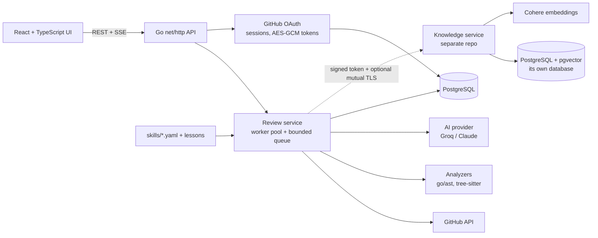

# PullWise: Code Reviewer and Mentor

An AI-assisted GitHub pull-request reviewer that **teaches** instead of just flagging.
Paste a PR link and PullWise reviews the changed code with exact, parser-based checks
and an AI pass, and every finding comes with the evidence, why it matters, how to fix
it, and a short lesson.

Sign in with GitHub to review your own **private** repositories; those reviews are
private to you.

## What makes it different

- **Facts are separated from judgment.** Deterministic analyzers (Go via `go/ast`,
  TypeScript via tree-sitter) only report *what they observed*. Severity, confidence,
  titles and lessons always come from versioned skill files, never from the analyzer
  or the model. Findings that don't match a defined check are dropped.
- **Skills are files.** A skill is a `skill.yaml` (what to check) plus `lessons/*.md`
  (what to teach). Adding a check or editing the AI's system prompt is editing text,
  not code.
- **AI with guardrails.** Groq (`gpt-oss-120b`) is called with strict JSON-schema
  constrained decoding behind a small `Provider` interface (a Claude implementation
  also exists). If the AI call fails, the review still completes with the
  deterministic findings.
- **Teaching UI.** Findings are filterable by severity and skill (language, REST, SOLID,
  then your own standards) and open into a page with evidence, explanation, improvement
  and lesson.
- **Your own standards.** Signed-in users write review rules in plain English ("never call
  the database from a handler"); the AI checks their pull requests against them. Each review
  keeps a copy of the rules it used.
- **Ask about the code.** A chat next to every finished review (findings on the left, chat on the
  right) and an Ask page for any repository. Answers come from the indexed code with numbered
  citations that link to the exact lines on GitHub; when the code does not say, it says so.

## Architecture



### The knowledge service (a separate repository)

[**pullwise-knowledge**](https://github.com/chxragsaxena/pullwise-knowledge) indexes a
repository's code and finds the parts related to a change, so the AI pass can judge a
change against the code around it instead of the diff alone. It is an independently
deployable service with its own repo, database, API contract and tests; PullWise calls
it over HTTP and never touches its database.

- **Per review:** PullWise downloads the repository's base commit in one GitHub
  request, sends the source files to the service (skipped when that commit is already
  indexed), searches it with the changed code, and adds the best matches to the AI
  prompt as read-only context.
- **Optional and non-fatal:** with no `KNOWLEDGE_URL`, or if the service is down, the
  review simply runs without extra context.
- **Secured service-to-service:** every call carries a short-lived signed token naming
  the tenant (a signed-in user's own index, or a shared one for anonymous reviews of
  public repos) and a minimal scope; mutual TLS is available so only callers holding a
  certificate from your CA can connect at all. Tenant isolation is enforced in the
  service and covered by tests. Details in that repository's README.

Design notes live in [docs/architecture.md](docs/architecture.md); the REST contract
is [docs/api.md](docs/api.md); progress and decisions are in
[docs/TRACKER.md](docs/TRACKER.md).

### Engineering highlights

- **Concurrency:** a fixed worker pool over a bounded FIFO queue (backpressure returns
  `503 server_busy`), per-review timeouts, panic recovery and graceful shutdown. The
  first design (a goroutine per review) was replaced after a test exposed
  out-of-order completion.
- **Live progress** over Server-Sent Events with keep-alive heartbeats.
- **Security:** GitHub OAuth with a CSRF `state` check, server-side sessions stored
  only as SHA-256 hashes, GitHub tokens encrypted at rest with AES-256-GCM, automatic
  refresh of rotating tokens, `HttpOnly`/`SameSite` cookies, and private reviews
  hidden from everyone but their owner (a hidden review is indistinguishable from a
  missing one).
- **Database:** PostgreSQL with embedded migrations applied at startup under an
  advisory lock; review completion is one transaction.
- **Languages:** deterministic checks for Go and TypeScript; the design skills
  (SOLID, REST) are AI-reviewed and apply to any recognised source language.
- **Tests:** table-driven unit tests, integration tests against real PostgreSQL, fake
  HTTP servers for every external API, and a frontend suite (Vitest + Testing
  Library). `gofmt`, `go vet` and `go test ./...` are kept green.

## Run it

You need Docker. The whole app (database, backend, web UI):

```
cp .env.example .env        # then set POSTGRES_PASSWORD (and optional keys below)
docker compose -f docker-compose.prod.yml up -d --build
```

Open http://localhost:8080.

To add the knowledge service (clone [pullwise-knowledge](https://github.com/chxragsaxena/pullwise-knowledge)
next to this repo, and set `KNOWLEDGE_JWT_SECRET`, `KNOWLEDGE_DB_PASSWORD` and `COHERE_API_KEY` in `.env`):

```
docker compose -f docker-compose.prod.yml -f docker-compose.knowledge.yml up -d --build
```

### Develop locally

```
docker compose up -d db                     # PostgreSQL only
cd backend  && go run ./cmd/server          # API on :8080 (needs a C compiler: tree-sitter uses cgo)
cd frontend && npm install && npm run dev   # UI on :5173
```

The frontend runs on a built-in mock API by default (demo mode). Set
`VITE_API_MODE=http` to use the real backend (see `frontend/.env.example`).

### Configuration

Everything is optional except the database. Missing keys switch features off rather
than breaking the app.

| Variable | Purpose |
|---|---|
| `POSTGRES_PASSWORD`, `DATABASE_URL` | Database (required) |
| `GROQ_API_KEY` | Enables the AI pass (free tier, no card) |
| `GITHUB_TOKEN` | Raises the anonymous GitHub rate limit (60 to 5,000 requests/hour) |
| `GITHUB_OAUTH_CLIENT_ID` / `_CLIENT_SECRET`, `SESSION_SECRET` | "Sign in with GitHub" and private-repo reviews (`SESSION_SECRET` is a base64 32-byte key) |
| `PUBLIC_URL`, `SECURE_COOKIES` | Set when deploying behind a real domain (use `https`) |
| `KNOWLEDGE_URL`, `KNOWLEDGE_JWT_SECRET` | Turns on the repository knowledge base (the separate service); the secret must match the service's `JWT_SECRET`. Optional `KNOWLEDGE_TLS_*` files enable mutual TLS. This also turns on Ask; `ASK_RATE_PER_MINUTE` / `ASK_BURST` limit it |

See [.env.example](.env.example) for the full list.

## Tests

```
cd backend  && go test ./...        # set TEST_DATABASE_URL to a *_test database to include the PostgreSQL tests
cd frontend && npm test
```

## Status

| | |
|---|---|
| Public-PR review, dashboard, Go + TypeScript analyzers, AI pass | Done |
| GitHub sign-in, private-repo reviews, private-by-owner results | Done |
| Repository knowledge base (retrieval over the repo with pgvector), as a separate service with signed-token auth and optional mutual TLS | Done and verified end to end. Retrieval is measured (below); how much it improves review quality is not |
| Your own review standards (per-user rules, snapshot per review) | Done and verified live |
| Ask: repository Q&A chat with cited answers, beside every review and on its own page | Done and verified live. Needs the knowledge service; retrieval can miss code (not yet measured) |
| GitHub App / webhooks | Not started |

### Retrieval quality (Ask)

`go run ./cmd/askeval` (needs the knowledge service and a Groq key) asks 33 questions about two
repositories and checks whether a file that answers each is among the 6 excerpts the AI is given.
One run, October 2026:

| Search | recall@6 | MRR |
|---|---|---|
| Source files only, vectors only (before the changes below) | 85% | 0.63 |
| Plus docs, SQL and config indexed, vectors only | 91% | 0.64 |
| Plus keyword search, merged with vectors | 85% | 0.60 |
| Plus the AI rewriting the question into search words | 97% | 0.74 |

Read it with care: I wrote the questions and the expected files, 33 is small, the rewrite step is
an AI call so a rerun can differ by a question or two, and the docs fix came from reading the
misses. Keyword search alone made things slightly worse; it helped only with the rewrite.
Questions about code are still missed sometimes (for example, "How are GitHub OAuth tokens
encrypted?" never returned `crypto.go`).

Known limits: AI findings are less reliable than the parser-based ones (they carry the
model's own confidence); only Go and TypeScript have exact checks; sharing a private
review with another person is not built.
